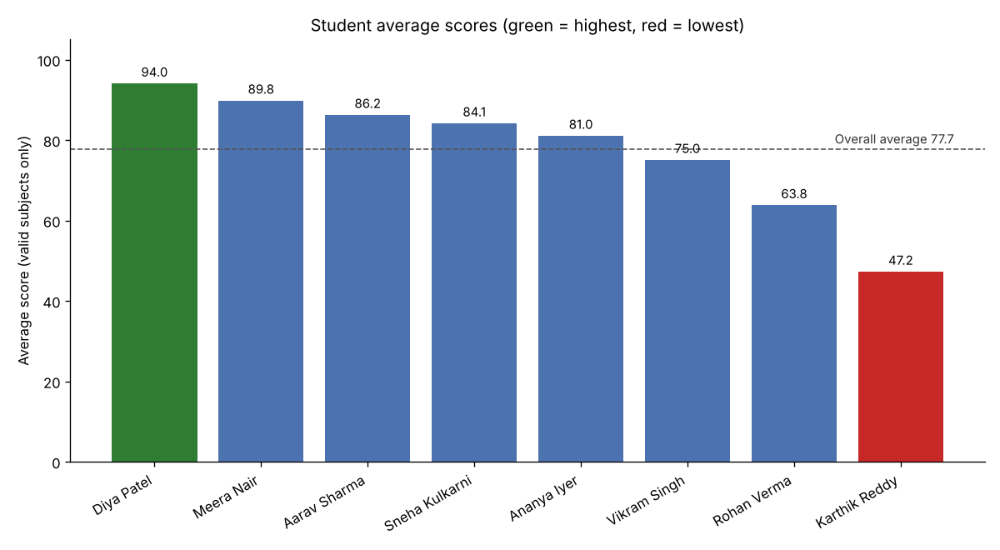

# AccuKnox – AI Security Engineer Trainee Assessment

**Candidate:** Bharathsimha Reddy Putta · bharathreddyget@gmail.com
**Education:** B.Tech Computer Science and Engineering (AI/ML), 2021–2025
**Skills:** Python, SQL, Machine Learning, Deep Learning, LLMs, RAG, AI Agents, MCP, APIs, Docker, MLOps

This repository contains my submission for all three assignments: executable Python and SQL with tests (Assignment 1), technical write-ups on LLM architecture, AI security and vector databases (Assignment 2), and a showcase of a real project (Assignment 3).

---

## Repository structure

```
accuknox-ai-security-assessment/
├── README.md
├── requirements.txt                  # runtime + test dependencies
├── assignment-1-python/
│   ├── README.md                     # task-by-task explanation, schemas, outputs
│   ├── api_to_sqlite.py              # Task 1: Open Library API -> SQLite (CRUD)
│   ├── student_scores.py             # Task 2: scores analysis + Matplotlib chart + CSV
│   ├── csv_to_sqlite.py              # Task 3: validated, transactional CSV importer
│   ├── advanced_python_example.py    # Task 4: async compliance pipeline (demonstration)
│   ├── advanced_database.sql         # Task 5: advanced SQL schema + queries (demonstration)
│   ├── sample_users.csv              # Task 3 sample data (with deliberate bad rows)
│   ├── data/
│   │   ├── student_scores.json       # Task 2 local mock-API fixture (synthetic)
│   │   └── sample_openlibrary_response.json
│   └── requirements.txt
├── assignment-2-ai-llm/
│   ├── self_assessment.md            # Q1
│   ├── llm_chatbot_architecture.md   # Q2 + AI security architecture
│   ├── vector_databases.md           # Q3 + Qdrant scenario design
│   ├── qdrant_acl_demo.py            # runnable ACL-filtered hybrid search demo
│   └── diagrams/
│       ├── chatbot_architecture.mmd
│       ├── ai_security_architecture.mmd
│       └── vector_database_architecture.mmd
├── assignment-3-project/
│   └── ghostagent_project_showcase.md
├── tests/                            # pytest suites (HTTP mocked, no network needed)
│   ├── conftest.py
│   ├── test_api_to_sqlite.py
│   ├── test_student_scores.py
│   ├── test_csv_to_sqlite.py
│   ├── test_advanced_examples.py
│   └── test_qdrant_acl_demo.py
└── docs/
    ├── setup_and_execution.md
    └── images/                       # rendered diagrams + sample chart
```

## Quick start

```bash
git clone https://github.com/bharathmrr/accuknox-ai-security-assessment. accuknox-ai-security-assessment
cd accuknox-ai-security-assessment
python -m venv .venv && source .venv/bin/activate     # Windows: .venv\Scripts\activate
pip install -r requirements.txt
pytest -v                                               # run the test suite

cd assignment-1-python
python api_to_sqlite.py fetch "clean code" --limit 5    # needs internet
python api_to_sqlite.py list
python student_scores.py
python csv_to_sqlite.py sample_users.csv --rejects output/rejected_rows.csv
python advanced_python_example.py
```

Full instructions, including every CLI option and expected output, are in [`docs/setup_and_execution.md`](docs/setup_and_execution.md).

## Assignment summaries

### Assignment 1 – Python and databases ([details](assignment-1-python/README.md))

| Task | Highlights |
|---|---|
| 1. API → SQLite | Open Library Search API. `(connect, read)` timeouts and backoff retries on 429/5xx only. Input validation. `CHECK`/`UNIQUE` constraints. Full CRUD with parameterised SQL and a column whitelist. Escaped `LIKE` filters. |
| 2. Student scores | Local mock-API fixture (no invented endpoint) and the same code over HTTP. Handles `null`, missing, non-numeric and out-of-range scores. Tie-aware highest/lowest. Bar chart and CSV. |
| 3. CSV → SQLite | Streaming reader. Email/phone/ID validation. In-file and in-DB duplicate detection. Single `BEGIN IMMEDIATE` transaction with **skip** or **strict (all-or-nothing)** modes. `import_runs` audit table. Rejected-rows CSV. |
| 4. Complex Python | `asyncio` pipeline with semaphore back-pressure, timeouts, jittered retries, a circuit breaker, a lock-guarded idempotency set, provider adapters, compliance rules, PII masking and a DLQ. |
| 5. Complex SQL | 9-table 3NF schema with FKs, CHECKs, a trigger, partial and covering indexes, transactions, an anti-join, CTEs, window functions, and verified `EXPLAIN QUERY PLAN` output. |



### Assignment 2 – AI, LLMs and vector databases

- [**Self-assessment**](assignment-2-ai-llm/self_assessment.md): A in LLM, Deep Learning, AI and Machine Learning, each backed by practical examples.
- [**LLM chatbot architecture**](assignment-2-ai-llm/llm_chatbot_architecture.md): 17 components, a 13-step request lifecycle, and **a threat model mapped to the OWASP LLM Top 10 (2025)**. It covers:
  - direct and indirect prompt injection, jailbreaks and data leakage,
  - insecure tool calling and excessive agency,
  - retrieval poisoning, malicious documents, hallucination, DoS and API abuse.

  Each threat has mitigations, and there is a separate security architecture diagram.
- [**Vector databases**](assignment-2-ai-llm/vector_databases.md): from embeddings to HNSW, filtering, hybrid search and security. Compares Pinecone, Weaviate, Milvus, Qdrant, Chroma and pgvector. Includes a full **Qdrant design for an access-controlled enterprise RAG system**, compared against pgvector and Pinecone.
- [`qdrant_acl_demo.py`](assignment-2-ai-llm/qdrant_acl_demo.py): runnable proof that the ACL filter blocks cross-group and over-clearance retrieval in a hybrid query.

### Assignment 3 – Project showcase

[**GhostAgent / DataRipple**](assignment-3-project/ghostagent_project_showcase.md) is AI-powered contact-centre compliance automation:

- Integrates Twilio, Vonage and RingCentral, plus 20+ CRMs including Salesforce and HubSpot.
- Handles 1,000+ interactions per day.
- Reported outcomes: 35% fewer compliance violations and 40% lower QA review time.

## Security practices used in the code

- **Parameterised SQL everywhere.** Injection payloads in the sample data are stored as inert text, and tests prove it.
- **No hard-coded credentials.** Secrets are read from environment variables, and nothing in the repo needs an API key.
- **Defensive validation** of every external input (API payloads, CSV rows, webhook bodies).
- **Bounded network calls.** Timeouts, limited retries, and no retries on non-transient errors.
- **PII masking** before logging, in the Task 4 pipeline.
- **Atomic transactions**, with an audit table for imports.

## Verification

| Check | Result |
|---|---|
| `pytest` | **80 passed** (Python 3.13, pytest 9.1; run in the build environment) |
| Python scripts | All five Assignment 1 scripts and the Qdrant demo executed successfully |
| SQL | `advanced_database.sql` executed on SQLite 3.53. Query plans confirmed index use |
| Mermaid | All diagrams rendered successfully with `@mermaid-js/mermaid-cli` 12.2 (PNG copies in `docs/images/`) |
| Style | `flake8 --max-line-length 100` clean |

## Assumptions and limitations

- **Network.** The build environment had no outbound access to openlibrary.org. Live API behaviour is covered by **mocked** tests, and `data/sample_openlibrary_response.json` is a **representative** response that follows the documented schema (placeholder keys), not a live capture. Run `fetch … --save-raw` to capture a real one.
- **Student data** is synthetic and served from a local fixture, because no reliable public student-score API exists.
- **Demonstration code.** Tasks 4 and 5 are demonstrations modelled on the GhostAgent problem domain. They are **not** production code from that project, and all external systems are mocked.
- **Dialect.** The advanced SQL targets SQLite so it can be executed anywhere. PostgreSQL differences are noted in the file and in the Assignment 1 README.
- **Product facts.** Vector-database capabilities change quickly. Facts were checked against vendor documentation in November 2026 and are cited.
- **Project figures.** The GhostAgent outcome figures are as reported by the project. No source code or URL is published, because the project is proprietary.
