# Question 3 – Vector Databases: Beginner to Advanced

> Product capabilities change quickly. Statements below were checked against vendor documentation in November 2026 where possible (see References). Verify versions before relying on a specific feature.

---

## Part A – Concepts

### 1. What embeddings are

An **embedding** is a fixed-length list of numbers (a vector, e.g. 384 or 1024 floats) that represents the *meaning* of a piece of data. A neural network is trained so that semantically similar inputs land close together in this vector space:

- "How do I reset my VPN password?" lands close to "Steps to change VPN credentials".
- Both land far from "Quarterly revenue grew 12%".

Embeddings exist for text, images, audio and code. For RAG we use **text embedding models**, which are usually transformer encoders trained with contrastive learning on query–passage pairs.

### 2. How text becomes a vector

```
"Reset VPN password"
   │ 1. Tokenise      → ["reset", "vp", "##n", "password"] → token IDs [3828, 21210, 2078, 20786]
   │ 2. Encode        → transformer layers produce one contextual vector per token
   │ 3. Pool          → mean-pool (or take [CLS]) → a single vector, e.g. 768 dims
   │ 4. Normalise     → divide by L2 norm so ||v|| = 1
   ▼
[0.021, -0.113, 0.094, …, 0.037]   (768 floats ≈ 3 KB as float32)
```

The same model and version must embed both documents and queries. Vectors from different models live in incompatible spaces.

### 3. Semantic similarity

Keyword search matches *words*. Semantic search matches *meaning*, so "laptop won't power on" retrieves a manual section titled "Device fails to boot", even with no shared keywords. The trade-off is that pure semantic search can miss exact identifiers (error codes, part numbers, names). That is why **hybrid search** (section 9) exists.

### 4. Cosine similarity

Cosine similarity measures the angle between vectors and ignores their length:

$$\cos(\mathbf{a},\mathbf{b}) = \frac{\mathbf{a}\cdot\mathbf{b}}{\|\mathbf{a}\|\,\|\mathbf{b}\|} \in [-1, 1]$$

Worked example with `a = [1, 2, 0]` and `b = [2, 3, 1]`:

- `a·b = 2 + 6 + 0 = 8`
- `‖a‖ = √5 ≈ 2.236`
- `‖b‖ = √14 ≈ 3.742`
- `cos ≈ 8 / 8.367 ≈ 0.956` (very similar)

For **L2-normalised** vectors, cosine similarity equals the dot product. Many engines normalise on insert and then use the cheaper dot product.

### 5. Euclidean distance

Euclidean (L2) distance is the straight-line distance:

$$d(\mathbf{a},\mathbf{b}) = \sqrt{\sum_i (a_i-b_i)^2}$$

For the same vectors: `√((1-2)² + (2-3)² + (0-1)²) = √3 ≈ 1.732`.

For unit vectors, `‖a−b‖² = 2 − 2·cos(a,b)`, so the two metrics produce **the same ranking**. Use whatever metric the embedding model was trained with; this is usually cosine or dot product for text models.

| Metric | Range | Good for |
|---|---|---|
| Cosine | −1…1 (higher = closer) | Text embeddings, where magnitude carries no meaning |
| Dot product | unbounded | Normalised vectors (equivalent to cosine), and models trained for dot product |
| Euclidean (L2) | 0…∞ (lower = closer) | Image and feature vectors where magnitude matters |

### 6. Approximate Nearest Neighbour (ANN)

Exact k-NN compares the query with **every** vector: O(N·d) per query. At 10 M vectors × 1024 dims, that is about 10 billion multiply-adds per query, which is too slow for interactive use.

ANN indexes trade a little **recall** (e.g. 95–99% of the true top-k) for orders-of-magnitude speed-ups. The main families are:

| Family | Idea | Examples |
|---|---|---|
| Graph-based | Navigate a proximity graph greedily | **HNSW**, Vamana / DiskANN |
| Partition / cluster | Search only the closest clusters | IVF (inverted file) |
| Quantisation | Compress vectors to cut memory and speed up distance computation | PQ, scalar (int8), binary quantisation |
| Hashing | Similar vectors collide in hash buckets | LSH |

### 7. HNSW (Hierarchical Navigable Small World)

HNSW [1] builds a **multi-layer graph**:

- Every vector is in layer 0. Exponentially fewer vectors appear in higher layers, so upper layers act like an "express highway".
- Search starts at the top layer, greedily moves to the neighbour closest to the query, then drops a layer and repeats.
- In layer 0, a beam search of width `ef` collects the final candidates.

```
Layer 2:  A ─────────────── F              (few nodes, long links)
Layer 1:  A ──── C ──── F ──── H
Layer 0:  A─B─C─D─E─F─G─H─I─J─K            (all nodes, short links)
          query enters at top → greedy descent → beam search at bottom
```

| Parameter | Effect | Typical value |
|---|---|---|
| `m` | Links per node. Higher means better recall, more memory and slower build | 16–64 |
| `ef_construct` | Beam width during build. Higher means a better graph and slower build | 100–512 |
| `ef` (search) | Beam width per query. **The main recall/latency knob at query time** | 64–256 |

Search costs roughly O(log N). The main costs are **RAM** (vectors plus graph) and **expensive deletes and updates**. Most engines mark deletions and rebuild segments in the background.

### 8. Metadata filtering

Real queries combine similarity with constraints, such as *"documents similar to X **where** department = HR **and** updated after 2025"*. There are three strategies:

- **Post-filtering:** run ANN, then drop non-matching results. This is fast, but restrictive filters can return too few results. pgvector added *iterative index scans* in 0.8.0 to address exactly this [6].
- **Pre-filtering:** filter first, then brute-force search the survivors. Results are exact but can be slow for large matches.
- **Filter-aware ANN:** apply the filter *during* graph traversal and use payload indexes to choose a strategy. Qdrant's planner switches between filtered HNSW and payload-index-based search depending on filter cardinality [2].

For security, **metadata filtering is how access control is enforced** (section 11). It must be correct and complete, not "best effort".

### 9. Hybrid search

Hybrid search combines **dense** (semantic) and **sparse** (lexical, e.g. BM25 or SPLADE) retrieval.

| Query | Dense alone | Sparse alone | Hybrid |
|---|---|---|---|
| "laptop won't start" | ✅ finds "device fails to boot" | ❌ no keyword overlap | ✅ |
| "error E-4021 on XR-200" | ⚠️ codes may embed poorly | ✅ exact token match | ✅ |

Ways to fuse results:

- **Reciprocal Rank Fusion (RRF):** `score = Σ 1/(k + rank_i)`. Needs no score calibration and is a strong default.
- **Weighted score fusion:** normalise each score and combine them as `α·dense + (1−α)·sparse`.
- **Re-ranking:** retrieve about 50 candidates with hybrid search, then re-score them with a **cross-encoder**. This gives the best quality at the cost of extra latency.

### 10. RAG integration

```
Offline:  documents → parse → chunk → embed → upsert (vector + payload: text, doc_id, ACL, …)
Online:   question → embed → hybrid search + ACL filter → re-rank → top-k chunks
          → prompt("Answer using only the context; cite sources") → LLM → answer + citations
```

Practical choices that matter more than the database brand:

- **Chunking quality:** keep heading context and do not split tables.
- **Embedding model choice:** evaluate on your own data, not only on leaderboards.
- **Hybrid search plus re-ranking.**
- **Evaluation:** measure recall@k of the right chunk, and answer faithfulness.

### 11. Vector database security

| Risk | Detail | Mitigation |
|---|---|---|
| **Unauthorised retrieval** | A user receives chunks from documents they cannot open in the source system | ACL payload on every point, a mandatory server-side filter from verified identity, ACL sync on permission changes, and automated cross-user leakage tests |
| **Embedding inversion** | Research shows text can be partially reconstructed from embeddings [8] | Treat vectors as being as sensitive as the source text: encrypt at rest, control access, never expose raw vectors in APIs |
| **Multi-tenant leakage** | A shared collection without filters | Tenant ID in payload with a tenant index, or separate collections / shards for high-isolation tenants. Tenant-scoped API keys |
| **Poisoning** | Malicious content inserted to steer answers | Write access only for the ingestion service, source allow-list, content hashes, audit of upserts |
| **Exposed endpoints** | Vector DB reachable from the internet with no authentication | Private network, TLS, API keys or JWT, read-only keys for query services |
| **Stale data after deletion** | A document is deleted in the source but still retrievable | Delete-propagation in sync jobs, periodic reconciliation, TTLs |
| **Data exfiltration through queries** | Systematic querying dumps the corpus | Per-user rate limits, result caps, anomaly detection |

### 12. Performance and scalability

**Memory.** Raw vector memory is about `N × d × 4 bytes`; 10 M × 1024 float32 is about 41 GB, plus the graph. To reduce it:

- **Quantisation:** scalar int8 cuts memory about 4×, binary about 32×. Combine with re-scoring against the original vectors.
- **On-disk vectors** with memory-mapping (mmap).

**Recall vs latency.** Tune `ef`, `m` and quantisation using a ground-truth set. Track p95/p99 latency, not only the average.

**Scaling out.**

- **Sharding** spreads data across nodes.
- **Replication** gives high availability and read throughput.
- Tenant-aware sharding keeps each tenant's data local.

**Ingestion throughput.**

- Batch upserts.
- Run embedding generation on GPU in parallel; this is usually the real bottleneck.
- Index after bulk load where supported.

**Filters.** Create **payload indexes** for every filtered field. Unindexed filters cause full scans.

---

## Part B – Comparison of popular vector stores

| | **Pinecone** | **Weaviate** | **Milvus** | **Qdrant** | **Chroma** | **PostgreSQL + pgvector** |
|---|---|---|---|---|---|---|
| Type | Fully managed SaaS (serverless and pod-based) | Open-source DB + managed cloud | Open-source distributed DB + managed (Zilliz Cloud) | Open-source engine (Rust) + managed cloud | Open-source, developer-first, embedded or client/server + cloud | Extension to PostgreSQL |
| Self-host | ❌ | ✅ | ✅ (Kubernetes, complex) | ✅ (single binary / Docker / K8s) | ✅ (simplest) | ✅ (anywhere Postgres runs) |
| Index types | Proprietary | HNSW, flat, dynamic | Many: HNSW, IVF variants, DiskANN, GPU indexes | HNSW + quantisation (scalar, product, binary) | HNSW | HNSW, IVFFlat |
| Filtering | Metadata filters | Filters with inverted index | Scalar filtering | Rich payload filters integrated with HNSW | Basic metadata `where` | Full SQL `WHERE`, joins |
| Hybrid search | Sparse-dense vectors | Built-in BM25 + vector fusion | Sparse + dense, multi-vector | Sparse vectors + Query API with prefetch and RRF / DBSF fusion | Limited | Via `tsvector` full-text + SQL fusion (DIY) |
| Multi-tenancy | Namespaces | Native multi-tenancy | Partitions / partition key | Payload partitioning with `is_tenant` index, custom shards, tiered multitenancy | Collections / tenants | Schemas, Row-Level Security |
| Strengths | Zero ops, quick start | Hybrid search and modules out of the box | Billion-scale, GPU acceleration | Filtering performance, low resource use, self-host friendly | Prototyping, notebooks, local dev | ACID, joins with business data, existing backups / HA / RLS |
| Watch-outs | Vendor lock-in, data leaves your VPC (except dedicated / BYOC options), cost at scale | Operational complexity at scale | Many components to operate | Separate system from your RDBMS | Not aimed at large, multi-tenant production | Vector scale and tuning limits; a large HNSW build is memory-hungry |

---

## Part C – Hypothetical problem: secure enterprise knowledge chatbot

### Problem

An enterprise has **thousands of PDFs, Word files, technical manuals and support records**. Employees need a chatbot that returns accurate answers. **Confidential documents must be retrievable only by authorised employees.**

Non-functional assumptions (stated because they drive the design):

- Roughly 50k documents, which becomes about 2–5 M chunks.
- About 2k employees, organised into groups.
- Four classification levels (Public, Internal, Confidential, Restricted).
- p95 retrieval latency under 300 ms.
- Data must stay in the company's cloud account.

### Decision: Qdrant

**Why Qdrant fits:**

1. **Access control lives in the query.** Payload filters such as `acl_groups ANY [...]` and `classification_level <= clearance` are evaluated *during* HNSW search, with payload indexes. Restrictive ACL filters therefore still return a full top-k and do not silently lose recall [2].
2. **Native hybrid search.** Named dense and sparse vectors in one collection, combined with the Query API (prefetch dense + sparse, fuse with RRF). This matters for manuals full of part numbers and error codes [3].
3. **Self-hostable inside the company VPC** (Docker / Kubernetes / Helm). This meets data-residency needs, and a managed option exists if operations capacity is limited.
4. **Built-in security features:**
   - TLS,
   - API keys plus **read-only keys**,
   - **JWT-based granular access** scoped to collections, and
   - tenant indexes (`is_tenant=true`) for efficient per-tenant data layout [4].
5. **Efficient at this scale.** About 5 M chunks fit comfortably on a small cluster, especially with scalar quantisation, and there is headroom to shard and replicate.

### Architecture

```mermaid
flowchart LR
    subgraph Sources["Document sources"]
        SP["SharePoint / OneDrive<br/>PDF, DOCX"]
        CONF["Confluence<br/>technical manuals"]
        TKT["Support system<br/>tickets, records"]
    end
    subgraph Ingest["Ingestion workers (Kafka/Celery queue)"]
        CONN["Connectors<br/>delta sync + deletes"]
        ACLX["ACL extractor<br/>groups, clearance, owner"]
        SCAN["Security scan<br/>malware, injection, PII tagging"]
        PARSE["Parser + OCR<br/>layout-aware"]
        CHUNK["Chunker<br/>headings, 300-800 tokens, overlap"]
        DENSE["Dense embedder<br/>e.g. bge / e5 / provider API"]
        SPARSE["Sparse encoder<br/>BM25 / SPLADE"]
    end
    subgraph Qdrant["Qdrant cluster (private network, TLS, API keys / JWT RBAC)"]
        COL[("Collection: enterprise_docs<br/>named vectors: dense + sparse<br/>payload: tenant_id, acl_groups,<br/>classification, doc_id, source, updated_at")]
        PIDX["Payload indexes<br/>tenant_id is_tenant=true,<br/>acl_groups keyword, classification"]
        SHARDS["Shards x replicas<br/>HNSW per segment"]
    end
    subgraph Query["Query path"]
        USER["Employee via chatbot"]
        AUTHZ["Auth service<br/>SSO token -> groups, clearance"]
        RETR["Retriever service<br/>builds mandatory ACL filter"]
        RERANK["Cross-encoder re-ranker"]
        LLM["LLM with citations"]
    end
    SP & CONF & TKT --> CONN --> ACLX --> SCAN --> PARSE --> CHUNK
    CHUNK --> DENSE & SPARSE
    DENSE & SPARSE -->|"upsert points + payload"| COL
    COL --- PIDX
    COL --- SHARDS
    USER --> AUTHZ -->|"verified claims"| RETR
    RETR -->|"hybrid query: prefetch dense + sparse,<br/>RRF fusion, filter: acl_groups ANY user_groups<br/>AND classification <= clearance"| COL
    COL -->|"authorised top-k"| RERANK --> LLM -->|"answer + source links"| USER
```



Source: [`diagrams/vector_database_architecture.mmd`](diagrams/vector_database_architecture.mmd).

### Document ingestion

1. **Connectors** pull new, changed and **deleted** files on a schedule or via webhooks. Each document gets a stable `doc_id`, a content hash and a version.
2. The **ACL extractor** reads the source system's permissions (SharePoint groups, Confluence space permissions, ticket visibility) and resolves them to directory group IDs. Documents with unresolvable ACLs default to **deny** and are routed for review.
3. The **security scan** checks for malware and file bombs, hidden or zero-width text, and instruction-like content (indirect prompt injection). It also tags PII.
4. **Parsing** is layout-aware (headings, tables, page numbers), with OCR for scanned PDFs.
5. **Chunking** produces 300–800-token chunks along section boundaries with overlap. Each chunk carries `title > section > subsection` breadcrumbs, which improves retrieval.

### Embedding generation

- **Dense:** one model and version for documents and queries (an open model such as the bge/e5 family self-hosted on GPU, or a provider API if policy allows). Choose it by **evaluating recall@10 on about 200 real employee questions**. The model name and version are stored in the payload.
- **Sparse:** BM25 or SPLADE vectors for exact terms such as product codes and error IDs.
- Embedding runs as batched GPU workers. Changing the model means a re-index into a **new collection** and an alias switch, with zero downtime.

### Metadata storage (payload) and collection setup

```python
from qdrant_client import QdrantClient, models
import os

client = QdrantClient(url=os.environ["QDRANT_URL"], api_key=os.environ["QDRANT_API_KEY"])

client.create_collection(
    collection_name="enterprise_docs_v1",
    vectors_config={"dense": models.VectorParams(size=1024, distance=models.Distance.COSINE)},
    sparse_vectors_config={"sparse": models.SparseVectorParams(modifier=models.Modifier.IDF)},
    quantization_config=models.ScalarQuantization(
        scalar=models.ScalarQuantizationConfig(type=models.ScalarType.INT8, always_ram=True)),
)
# Index every field used in filters (unindexed filters = slow scans).
client.create_payload_index("enterprise_docs_v1", "tenant_id",
    field_schema=models.KeywordIndexParams(type="keyword", is_tenant=True))
client.create_payload_index("enterprise_docs_v1", "acl_groups", models.PayloadSchemaType.KEYWORD)
client.create_payload_index("enterprise_docs_v1", "classification_level", models.PayloadSchemaType.INTEGER)
client.create_payload_index("enterprise_docs_v1", "doc_id", models.PayloadSchemaType.KEYWORD)
client.update_collection_aliases(change_aliases_operations=[models.CreateAliasOperation(
    create_alias=models.CreateAlias(collection_name="enterprise_docs_v1", alias_name="enterprise_docs"))])
```

Example point payload:

```json
{
  "tenant_id": "acme",
  "doc_id": "SP-HR-2291",
  "chunk_index": 4,
  "title": "Leave Policy 2026 > Parental leave > Eligibility",
  "text": "Employees with at least 6 months of service are eligible for ...",
  "source": "sharepoint",
  "source_url": "https://acme.sharepoint.com/sites/hr/...",
  "acl_groups": ["grp-hr", "grp-all-employees"],
  "classification_level": 1,
  "content_sha256": "9f2c...",
  "embedding_model": "dense-model@v1",
  "updated_at": "2026-10-01T09:00:00Z"
}
```

### Similarity search, access-control filtering and hybrid search in one query

```python
def secure_hybrid_search(question: str, claims: dict, dense_vec, sparse_vec, k: int = 8):
    """`claims` comes from the verified SSO token - never from the request body or the LLM."""
    acl = models.Filter(must=[
        models.FieldCondition(key="tenant_id", match=models.MatchValue(value=claims["tenant_id"])),
        models.FieldCondition(key="acl_groups", match=models.MatchAny(any=claims["groups"])),
        models.FieldCondition(key="classification_level",
                              range=models.Range(lte=claims["clearance_level"])),
    ])
    return client.query_points(
        collection_name="enterprise_docs",
        prefetch=[  # the filter is applied inside EACH branch, so nothing unauthorised is fused
            models.Prefetch(query=dense_vec, using="dense", filter=acl, limit=40),
            models.Prefetch(query=sparse_vec, using="sparse", filter=acl, limit=40),
        ],
        query=models.FusionQuery(fusion=models.Fusion.RRF),
        limit=k * 3,           # candidates for the cross-encoder re-ranker
        with_payload=True,
    ).points
```

The retriever service holds a **read-only** Qdrant key, and only the ingestion service holds a write key. The query service has no way to skip the ACL filter, because filter construction lives in one audited function covered by tests.

### Scalability

| Stage | Approach |
|---|---|
| Today (about 5 M chunks) | 3-node cluster, collection with 6 shards and replication factor 2. INT8 quantisation keeps vectors in RAM (about 5 GB instead of 20 GB at 1024 dims), with originals on disk for re-scoring. |
| Growth (50 M+) | Add nodes and rebalance shards. Move originals to on-disk/mmap. Consider binary quantisation with oversampling. |
| Large or isolated business units | Separate collections or custom shard keys per unit, and tiered multitenancy for very large tenants [4]. |
| Ingestion bursts | A queue in front of the embedding workers, batched upserts, autoscaled GPU workers. |

### Deployment

- Kubernetes using the official Helm chart, with StatefulSets and persistent SSD volumes. Nodes are spread across availability zones.
- A private subnet only. A NetworkPolicy allows ingress solely from the retriever and ingestion services. TLS for client and inter-node traffic.
- Secrets (API keys / JWT signing key) come from a secrets manager. Read-only and read-write keys are separate and rotated regularly.
- Snapshots go to encrypted object storage, with restore tested regularly.
- Prometheus metrics (latency, RAM, segment counts) and alerts. Blue/green re-index via collection aliases.

### Security considerations

1. **Identity-bound filters on every query.** Automated tests attempt cross-group and over-clearance retrieval and must return zero results.
2. **ACL freshness.** Permission changes and deletions propagate within minutes (webhooks plus nightly reconciliation). Revoked access is treated as a P1 incident if stale.
3. **Defence in depth.** After retrieval, a second authorisation check against the source system (or a cached ACL service) runs for Restricted documents before they enter the prompt.
4. **Indirect injection.** Retrieved text is spotlighted as untrusted data. Ingestion-time scanning flags suspicious documents. Tools are never triggered purely by retrieved content.
5. **Vectors are sensitive data.** Encrypt disks and snapshots. Never return raw vectors to clients (`with_vectors=False`).
6. **Audit.** Log `user_id`, the query hash, the returned `doc_id`s and the filter used. Ship logs to the SIEM and alert on unusual retrieval volume.
7. **Restricted data minimisation.** Documents above a set classification can be excluded from the index entirely, if the business does not need them in chat.

### Comparison for this scenario

| Criterion | **Qdrant** (chosen) | **PostgreSQL + pgvector** | **Pinecone** |
|---|---|---|---|
| ACL-filtered ANN quality | Filter-aware HNSW with payload indexes, designed for restrictive filters | Post-filtering by default. `hnsw.iterative_scan` (0.8.0+) mitigates over-filtering; tuning required [6] | Metadata filtering is supported. Behaviour is managed by the vendor and opaque to tune |
| Hybrid search | Native sparse + dense with RRF in one query | DIY: `tsvector` full-text + vector query + SQL fusion | Sparse-dense supported |
| Data residency / VPC | Self-host anywhere, or managed | Self-host anywhere | SaaS (check dedicated / BYOC options and regions) |
| Ops effort | A new system to run (moderate) | Lowest **if Postgres is already operated**; reuses backups, HA and **Row-Level Security** | Lowest overall |
| Joins with relational data | No (store needed fields in payload) | ✅ Native SQL joins and transactions | No |
| Scale headroom | Sharding, replication, quantisation | Good to millions of vectors; very large HNSW builds need lots of RAM and maintenance | Scales automatically, priced on usage |
| When I'd pick it instead | – | Corpus is small or moderate, the team is Postgres-strong, and transactional consistency between documents and metadata matters most | No ops team, fast time-to-market, and SaaS acceptable under data policy |

**Conclusion.** Qdrant gives the best balance for this scenario. It combines strong filtered-search correctness, which is the core security requirement, with native hybrid retrieval and in-VPC deployment. pgvector is a credible, simpler alternative for a smaller corpus. Pinecone suits teams that prefer to buy rather than run infrastructure, if data policy allows SaaS.

---

## References

1. Malkov & Yashunin, *Efficient and robust approximate nearest neighbor search using Hierarchical Navigable Small World graphs* (2016/2018): https://arxiv.org/abs/1603.09320
2. Qdrant docs – Filtering and indexing: https://qdrant.tech/documentation/
3. Qdrant docs – Hybrid queries (Query API, prefetch, fusion): https://qdrant.tech/documentation/
4. Qdrant docs – Multitenancy (`is_tenant` payload index, from v1.11; tiered multitenancy, from v1.16): https://qdrant.tech/documentation/manage-data/multitenancy/
5. Qdrant docs – Security (API keys, read-only keys, JWT RBAC, TLS): https://qdrant.tech/documentation/
6. pgvector 0.8.0 release (iterative index scans): https://www.postgresql.org/about/news/pgvector-080-released-2952/ and https://github.com/pgvector/pgvector
7. Cormack, Clarke & Büttcher, *Reciprocal Rank Fusion outperforms Condorcet and individual rank learning methods* (SIGIR 2009)
8. Morris et al., *Text Embeddings Reveal (Almost) As Much As Text* (2023): https://arxiv.org/abs/2310.06816
9. Pinecone documentation: https://docs.pinecone.io/ · Weaviate: https://weaviate.io/developers/weaviate · Milvus: https://milvus.io/docs · Chroma: https://docs.trychroma.com/
