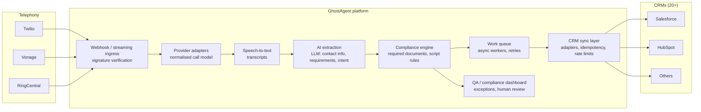

# Assignment 3 – Project Showcase: GhostAgent / DataRipple

> **What is real and what is not.**
> - **Real professional experience:** the project description, integrations and outcome figures in this document are from my work on GhostAgent / DataRipple, as reported by the project.
> - **Not in this repository:** the project's source code is proprietary. There is no public GitHub link, and none is given.
> - **Demonstration code only:** `assignment-1-python/advanced_python_example.py` and `advanced_database.sql` are **demonstrations written for this assessment** that illustrate the same kind of engineering problems. They are not extracts from the production system.
> - **Generic technology names:** where this document names specific technology choices beyond those listed below (e.g. queue or database products), they describe the general architecture pattern. They are labelled *"typical"* where I am describing an approach rather than a confirmed implementation detail.

---

## 1. Project overview

**GhostAgent / DataRipple** is an AI-powered **contact-centre compliance automation** platform. It listens to live customer and sales calls and:

- extracts customer contact information, requirements and intent,
- detects missing or non-compliant documentation, and
- updates the organisation's CRM automatically, without agents doing manual data entry.

| Fact | Value |
|---|---|
| Telephony integrations | Twilio, Vonage, RingCentral |
| CRM integrations | 20+ CRMs, including Salesforce and HubSpot |
| Volume | 1,000+ interactions per day |
| Reported outcomes | **35% fewer compliance violations**, **40% lower QA review time** |

## 2. Problem being solved

In regulated sales and support (lending, insurance, financial services), every customer interaction must follow scripts and collect specific documents and consents. The manual process before automation had three problems:

- **Agents re-type call details into the CRM.** This is slow and error-prone, and data is often incomplete.
- **QA teams sample only a small fraction of calls** by listening to recordings. Violations (a missing consent, a prohibited claim, a missing KYC document) are found late or not at all.
- **Compliance gaps surface during audits,** when they are expensive to fix.

GhostAgent automates capture, checks every interaction against compliance rules, and only routes exceptions to humans.

## 3. Architecture and technology

**Main building blocks:**

- **Core language:** Python, with asynchronous service code for high-concurrency I/O against telephony and CRM APIs.
- **AI:** LLM-based information extraction and intent classification from transcripts, with structured (schema-validated) outputs.
- **Integration layer:**
  - provider adapters for three telephony platforms, and
  - CRM connectors for 20+ systems, each with its own authentication, data model and rate limits.
- **Data:** a relational store for calls, extracted entities, compliance findings and sync audit. *Typical* pattern; `advanced_database.sql` shows an illustrative schema for this domain.
- **Operations:** containerised services (Docker), API-based deployment, logging and monitoring.

## 4. Data flow

1. **Call event:** a telephony provider sends a webhook or stream for a live or completed call.
2. **Ingress and normalisation:** the event is authenticated, de-duplicated and converted into a provider-independent call record.
3. **Transcription:** audio becomes text (speaker-separated where available).
4. **AI extraction:** the LLM extracts contact details, customer requirements and intent into a validated schema.
5. **Compliance evaluation:** rules check the required documents and consents for that intent, plus prohibited statements. Low-confidence or high-risk cases are flagged for human review.
6. **CRM update:** the record is created or updated in the customer's CRM through the matching connector. Retries, idempotency and an audit trail protect it.
7. **QA dashboard:** compliance officers see exceptions instead of sampling random calls, which is the source of the reduced QA review time.

## 5. AI components

| Component | Role |
|---|---|
| Speech-to-text | Converts call audio into transcripts for downstream analysis |
| LLM extraction | Pulls structured fields (name, phone, email, requirements) from unstructured conversation |
| Intent classification | Determines what the customer wants (e.g. a product enquiry versus support), which decides which compliance rules apply |
| Compliance detection | Combines AI understanding with deterministic rules to detect missing documents and non-compliant language |
| Confidence and escalation | Routes uncertain outputs to human QA instead of auto-committing them to the CRM |

## 6. Integrations

- **Telephony:** Twilio, Vonage, RingCentral. Each has different webhook formats, call identifiers, authentication and recording/transcript access.
- **CRMs:** 20+ systems including Salesforce and HubSpot. Each has different object models (lead / contact / deal), field mappings, OAuth flows, API quotas and error semantics.
- **Internal:** a compliance dashboard and QA workflow for human review of flagged interactions.

## 7. Why it is technically difficult

1. **Real-time, unreliable, multi-vendor input.** Three telephony providers with different payloads and redelivery behaviour feed one pipeline handling 1,000+ daily interactions. Processing must stay correct (no duplicates, no lost calls) while concurrency stays bounded.
2. **AI output must be trustworthy enough to write into systems of record.** Messy, spoken, multi-speaker conversation has to become validated structured data. Uncertain results go to humans rather than silently corrupting a CRM, because a wrong field there has compliance consequences.
3. **Integration surface area.** 20+ CRMs each have their own schema, authentication, rate limits and failure modes. Keeping updates idempotent and auditable across them, with consistent compliance semantics, is a large and continuous engineering effort.

## 8. Security considerations relevant to AccuKnox

- Call transcripts contain **PII** (phone numbers, emails, ID numbers). Masking before logging and minimising data sent to external models are essential.
- Transcripts are **untrusted input to an LLM**. A caller could, in principle, say text intended to manipulate extraction (indirect prompt injection), so extracted fields are schema- and rule-validated before reaching a CRM.
- CRM connectors hold **high-value OAuth tokens**. They need secrets management, least-privilege scopes and audit logging of every write.
- Webhook endpoints must verify **provider signatures** to prevent forged call events.
